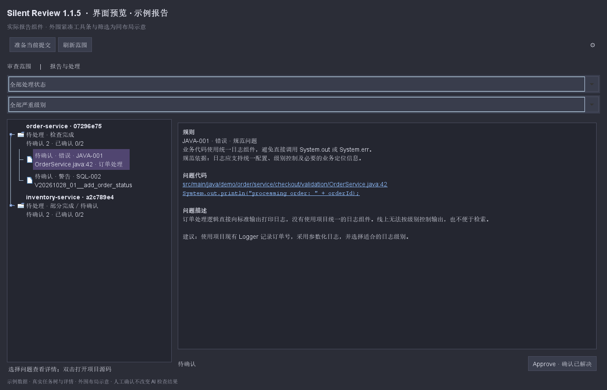
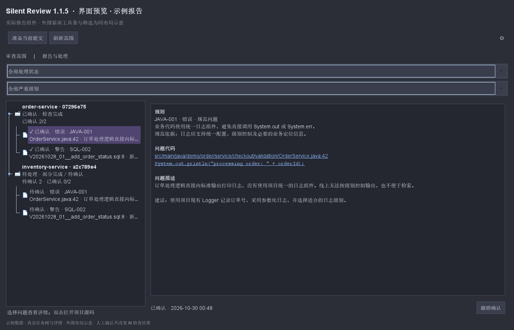
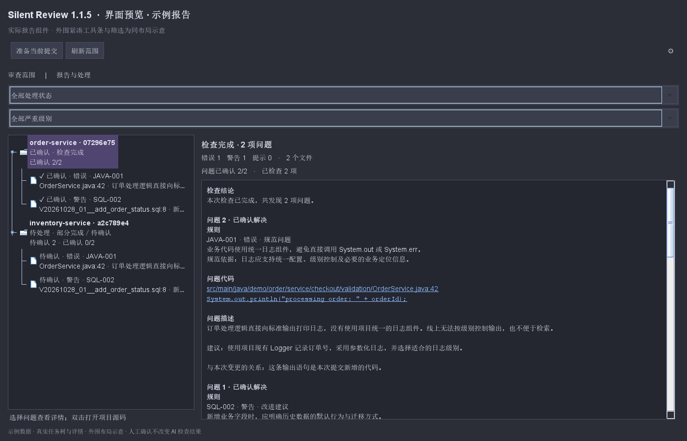

# 报告浏览与逐问题确认

1.1.5 保留“检查任务 → 具体问题”的两级目录，右侧改为单页报告，取消内部标签页和重复导航按钮。

## 子问题：三个区块

选择具体问题后，只展示以下内容：

- **规则**：规则编号与实际规范要求；规则定义可用时显示要求或引用摘录。
- **问题代码**：文件路径、行号和代码证据。点击路径或证据，定位当前项目中的真实源码并选中对应代码行。
- **问题描述**：原因和建议处理方式，集中在同一区块中。

没有“打开项目源码”“查看提交快照”“展开规范与变更说明”按钮，也不再切换“问题详情／检查明细／报告信息”标签页。模型文字按普通文本显示，不会被作为 HTML 或外部链接执行。

定位使用当前文档，包括未保存的修改。代码移动后按唯一证据重新定位；无法唯一对应时仅作近似定位并提示。文件已删除或路径无效时会说明原因，不会改为打开其他仓库同名文件。

## 父任务：完整报告

选择一次检查的父节点，在同一滚动页面中查看任务结论、全部问题、规范及变更说明、检查覆盖和未完成原因、限制说明、报告信息及人工处理记录。父页每条问题的路径和证据也能定位项目源码，跳转保留原始问题索引，不受显示排序影响。

父页用于阅读完整报告；逐条确认仍在子问题页进行。报告摘要和任务树保留确认进度，错误、取消、部分完成以及待补查状态不会因人工确认被改写。

## 默认检查当前项目的仓库

“准备当前提交”和“刷新范围”自动发现当前 IDEA 项目中的 Git 根，包括已登记根、项目或内容根中有界扫描发现的兄弟及嵌套仓库。已移除顶部与报告页的仓库选择器。

审查范围显示全部发现的仓库和文件，仍可按文件纳入或排除；“全部纳入／全部排除”作用于全部仓库。“开始审查”处理这些仓库中已纳入的文件；单个仓库准备失败仍会显示原因，其他仓库可继续。

报告页默认显示本项目保存的报告，保留处理状态与严重级别筛选。原有任务树选中高亮、长标题省略和悬停提示继续保留。

## Approve：确认这条问题已解决

处理完问题后，点击右下角 **Approve · 确认已解决**。确认后显示时间，按钮变为“撤销确认”；重启后仍可读取。撤销追加历史，不删除原记录。

当任务所有问题都逐条确认时，任务自动变为“已确认”；撤销其中一条后恢复待处理。旧版主动关闭或采纳的任务保留原处理决定。界面已移除上方重复的“处理／不处理”按钮。

确认不会修改代码或重新调用 AI，也不会把部分完成、失败、取消变成检查通过。逐问题记录绑定报告 ID、原始问题索引和内容指纹；新报告不会继承旧问题的确认。

## 保存与导出

原报告与旧版人工处理记录继续读取。确认数据与任务历史保存在本地报告目录的 `resolutions.json`，格式为 schema 2，兼容 schema 1。

报告存于 IDEA 系统目录的 `silent-review/<项目 locationHash>/`。Windows 默认通常位于 `%LOCALAPPDATA%/JetBrains/<IDE产品和版本>/silent-review/`；若自定义 `idea.system.path`，以自定义目录为准。报告 JSON 和确认记录均不写入项目源码目录。

右击任务目录可导出所选报告或清理历史。导出保留完整报告、覆盖信息和逐问题确认／撤销记录；导出位置由保存对话框选择。

## 界面示例

以下使用实际生产报告 Swing 组件与通用示例数据，外围工具栏与筛选为同布局示意，主题由预览程序模拟，并非完整 IDEA 窗口截图。

子问题单页：

确认后：

父任务完整报告：

